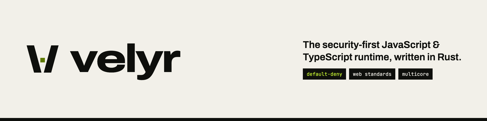

<p align="center">
  <picture>
    <source media="(prefers-color-scheme: dark)" srcset=".github/assets/brand/banner-dark.png">
    
  </picture>
</p>

<p align="center">
  <a href="https://github.com/velyrlabs/velyr/actions/workflows/ci.yml"></a>
  <a href="https://github.com/velyrlabs/velyr/releases"></a>
  <a href="#license"></a>
</p>

> **Status: alpha (`v0.1.0-alpha.1`).** APIs, CLI flags and behavior may change
> without notice. Velyr is not ready for production use. Node.js compatibility
> is partial and experimental, and performance work is ongoing (see
> [What works](#what-works-and-what-does-not-yet)).

## Install

### Prebuilt binaries

Binaries are published on [GitHub Releases](https://github.com/velyrlabs/velyr/releases)
for Linux x64/arm64 (gnu and musl), macOS x64/arm64 and Windows x64, as
`velyr-<target>.tar.gz` (`.zip` on Windows). Each release also ships
`SHA256SUMS`, a CycloneDX SBOM and build provenance attestations.

```sh
# macOS on Apple silicon (use x86_64-unknown-linux-gnu for Linux x64)
TARGET=aarch64-apple-darwin
BASE=https://github.com/velyrlabs/velyr/releases/download/v0.1.0-alpha.1

curl -fLO "$BASE/velyr-$TARGET.tar.gz"
curl -fLO "$BASE/SHA256SUMS"

# Verify the checksum (use `sha256sum` instead of `shasum -a 256` on Linux)
grep "velyr-$TARGET.tar.gz" SHA256SUMS | shasum -a 256 -c -

# Verify the build provenance attestation (requires the GitHub CLI)
gh attestation verify "velyr-$TARGET.tar.gz" --repo velyrlabs/velyr

tar -xzf "velyr-$TARGET.tar.gz"
./velyr --version
```

Move the `velyr` binary somewhere on your `PATH`.

### Build from source

Requires a Rust toolchain (the version is pinned in `rust-toolchain.toml`).

```sh
git clone https://github.com/velyrlabs/velyr
cd velyr
cargo build --release -p velyr-cli
./target/release/velyr --version
```

## Quick start

Run a JavaScript file:

```sh
echo 'console.log("hello from velyr")' > hello.js
velyr run hello.js
```

Run TypeScript. Types are stripped, not checked, so execution does not need
`tsc`:

```ts
// hello.ts
const greet = (name: string): string => `hello, ${name}`;
console.log(greet("velyr"));
```

```sh
velyr run hello.ts
```

Type check with the project's own TypeScript (`tsc --noEmit`):

```sh
velyr check
```

Serve a module that exports a `fetch` handler:

```ts
// server.ts
export default {
  fetch(req: Request): Response {
    return new Response("hello from velyr");
  },
};
```

```sh
velyr serve --hostname 127.0.0.1 --port 8000 --allow-listen=127.0.0.1:8000 server.ts
curl http://127.0.0.1:8000
```

Other subcommands: `x` (run a `node_modules/.bin` binary), `test`, `bench`,
`compat` (report Node API and package usage), `compile` (bundle into a single
executable), `add`, `remove` and `install`. Run `velyr --help` for details.

## Permissions

Scripts start with no access to the filesystem, network, environment or
system information. Grant only what a program needs:

| Flag | Grants |
|------|--------|
| `--allow-read[=PATHS]` | Read files |
| `--allow-write[=PATHS]` | Write files |
| `--allow-net[=HOST[:PORT]]` | Outbound network |
| `--allow-listen[=ADDR[:PORT]]` | Listen for inbound connections |
| `--allow-env[=NAMES]` | Read environment variables |
| `--allow-sys[=NAMES]` | System information APIs |
| `-A`, `--allow-all` | Everything except native loading and the inspector |

Scopes are comma-separated and require `=`, for example
`--allow-read=./data,./config`. Matching `--deny-*` flags exist, and deny wins
over allow. Further flags (`--allow-run`, `--allow-native`, `--allow-import`,
`--inspect`) are listed in `velyr run --help`.

`-A` reaches loopback addresses but not private network ranges. Permissions
are an application-level boundary, not a sandbox against hostile code; see
[docs/SECURITY.md](docs/SECURITY.md) for known limitations.

## What works and what does not yet

Works today:

- ES modules and classic scripts on the default V8 engine, with TypeScript and
  JSX by type stripping.
- Web-standard APIs such as `fetch`, streams, Web Crypto and WebSocket, with
  coverage tracked in the compatibility documents.
- HTTP serving through `export default { fetch }`, with optional multiple
  worker isolates (`--workers`).
- Dependency management (`add`, `remove`, `install`) with a `velyr.lock`
  lockfile, plus `test`, `bench` and `compile`.

Not there yet:

- **Node.js compatibility is partial and experimental.** Many modules pass only
  a small sample of behavior tests. See
  [docs/COMPATIBILITY-MATRIX.md](docs/COMPATIBILITY-MATRIX.md) for per-module
  status. Do not assume an arbitrary npm package works.
- **Performance is not yet competitive** with Node.js, Deno or Bun on HTTP
  throughput. No benchmark numbers are published for this release.
- **The native engine is experimental.** An engine written in Rust can be
  selected with `--engine native`, but only in builds with the `engine-native`
  Cargo feature, so prebuilt binaries may not include it. V8 is the default.
- Stability guarantees, a finished security audit and a 1.0 API are not
  provided. See [docs/RELEASE-CRITERIA.md](docs/RELEASE-CRITERIA.md) and
  [docs/ROADMAP.md](docs/ROADMAP.md).

## Project layout

- [`crates/`](crates/): the runtime as a Cargo workspace (`cli`, `engine-*`,
  `runtime-*`, `web-*`, `io-*`, `compat-*`, `tooling-*`, `qa-*`).
- [`docs/`](docs/): product requirements, technical design, specifications,
  security model, compatibility and performance plans.
- `compat/`, `benches/`, `fuzz/`, `tests/`: compatibility results, benchmarks,
  fuzz targets and tests.

## Documentation

Start at [docs/README.md](docs/README.md), which lists the PRD, TDD, SPEC,
roadmap, architecture decision records and the security and compatibility
documents.

## Security

See [docs/SECURITY.md](docs/SECURITY.md) for the security program and known
limitations. Report vulnerabilities privately through GitHub private
vulnerability reporting on the
[velyrlabs/velyr](https://github.com/velyrlabs/velyr/security) repository
(Security tab, "Report a vulnerability"). Please do not open public issues for
security problems.

## License

Licensed under either of [Apache License, Version 2.0](LICENSE-APACHE) or
[MIT license](LICENSE-MIT) at your option.
